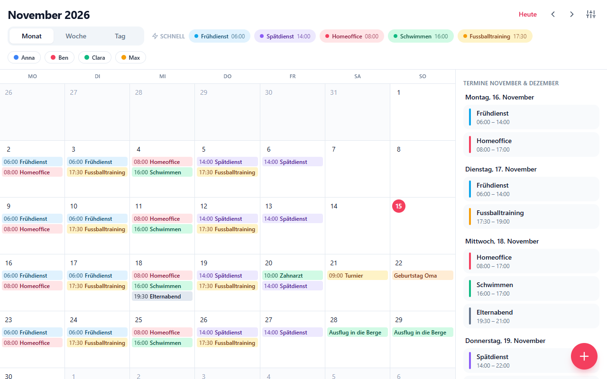
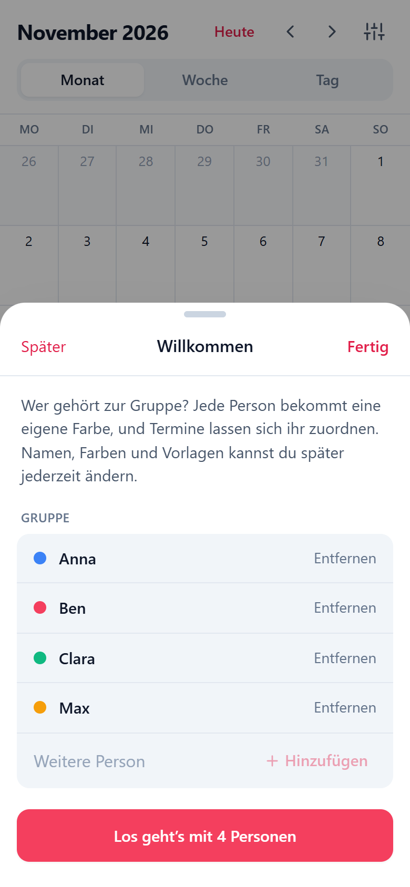
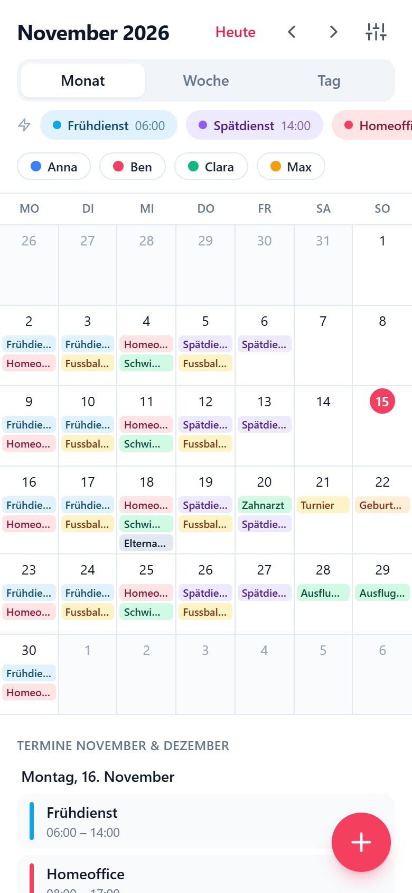
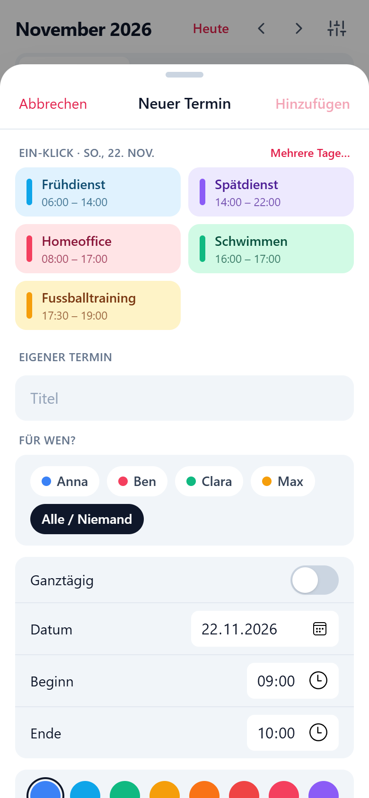
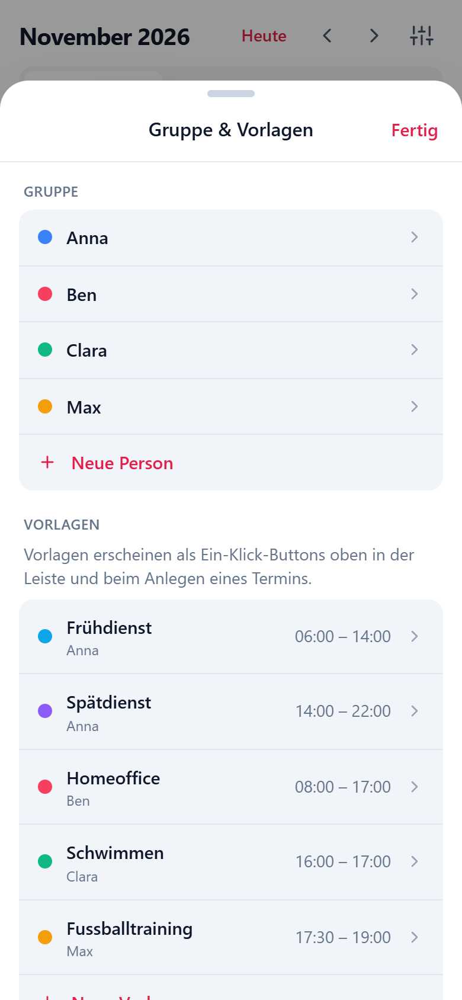

# PrivateGroupCalendar

Ein gemeinsamer Kalender für eure Familie, WG oder euren Verein, gehostet in **eurem eigenen Cloudflare-Konto**.
Für das Smartphone gebaut, mit Monats-, Wochen- und Tagesansicht, Farben pro Person und Ein-Klick-Vorlagen für
wiederkehrende Termine wie Schichten oder Training.



> [!IMPORTANT]
> **Die App hat keine eigene Anmeldung.** Ohne Zugriffsschutz kann jeder, der die Adresse kennt, alle Termine sehen und ändern.
> Richte deshalb **vor** dem ersten Hochladen Cloudflare Access ein (kostenlos bis 50 Personen), siehe
> [Schritt 4: Zugriff schützen](#4-zugriff-schützen-wichtig).

## Funktionen

- **Monat, Woche, Tag**: auf dem Smartphone mit Wischen zum Blättern, am Desktop mit Terminliste daneben
- **Personen mit Farben**: Jeder Termin kann einer Person zugeordnet werden. Über die Namen oben blendet man Personen ein und aus.
- **Ein-Klick-Vorlagen**: z. B. „Frühdienst 06:00–14:00“ einmal anlegen, danach mit einem Tipp eintragen
- **Mehrere Tage auf einmal**: Vorlage wählen, Tage im Mini-Kalender antippen, optional wöchentlich wiederholen
- **Rückgängig** nach jedem Eintragen und Löschen
- **Einrichtungs-Assistent** beim ersten Start
- **Als App auf dem Home-Bildschirm** (Web-App, kein App Store nötig)
- **Erweiterbarer Import**: eigene Dateiformate lassen sich als Modul ergänzen, siehe [Import-Formate](#import-formate)
- **Hell- und Dunkelmodus** folgen der Systemeinstellung

| Einrichtung | Monat | Neuer Termin | Gruppe & Vorlagen |
|---|---|---|---|
|  |  |  |  |

Die Screenshots zeigen erfundene Demo-Daten.

## Was du brauchst

- Ein kostenloses [Cloudflare-Konto](https://dash.cloudflare.com/sign-up)
- [Node.js](https://nodejs.org/) 20.19 oder neuer
- Etwa 20 Minuten für die erste Einrichtung

Cloudflare Pages, D1 und Access reichen für eine Familie oder kleine Gruppe im kostenlosen Rahmen.

## Einrichtung

### 1. Projekt holen und lokal ausprobieren

```bash
git clone https://github.com/Fil500/PrivateGroupCalendar.git
cd PrivateGroupCalendar
npm install
npm run dev
```

Ohne Backend startet die App unter http://localhost:5173 in einem **Demo-Modus**: Die Daten bleiben nur in diesem Browser.
So kannst du alles ausprobieren, bevor du etwas bei Cloudflare anlegst.

### 2. Datenbank bei Cloudflare anlegen

```bash
npx wrangler login
npm run db:create
```

`db:create` gibt eine `database_id` aus. Trage sie in `wrangler.toml` ein, dann:

```bash
npm run db:migrate:remote
```

### 3. Pages-Projekt anlegen, aber noch nichts hochladen

```bash
npx wrangler pages project create private-group-calendar --production-branch main
```

Cloudflare nennt dir die Adresse, z. B. `private-group-calendar-abc.pages.dev`. Ist der Name schon vergeben, hängt
Cloudflare ein Kürzel an. `name` in `wrangler.toml` bleibt trotzdem gleich, nur die Adresse ist anders.

### 4. Zugriff schützen (wichtig)

Im Cloudflare-Dashboard:

1. **Workers & Pages → dein Projekt → Settings → General → Access policy** aktivieren. Beim ersten Mal fragt Cloudflare
   nach einem Teamnamen und dem Zero-Trust-Plan: **Free** wählen.
2. Bei der entstandenen Access-Anwendung auf **Manage** gehen. Unter **Destinations / Public hostnames** müssen
   **beide** Adressen stehen, sonst ist die Hauptadresse offen:
   - `*.deine-adresse.pages.dev` (Vorschau-Versionen, legt Cloudflare meist selbst an)
   - `deine-adresse.pages.dev` (über **Add public hostname** ergänzen, Subdomain-Feld **leer** lassen)
3. Unter **Policies**: Aktion **Allow**, bei *Include* **Emails** mit den Adressen aller Mitglieder.
4. Unter **Login methods**: **One-time PIN** (Code per E-Mail, keine Passwörter nötig).
5. Speichern und prüfen. Ohne Anmeldung muss **jede** dieser Adressen auf eine Seite `….cloudflareaccess.com` umleiten:

   ```bash
   curl -sI https://deine-adresse.pages.dev/ | grep -i location
   curl -sI https://deine-adresse.pages.dev/api/members | grep -i location
   curl -sI https://test.deine-adresse.pages.dev/ | grep -i location
   ```

Die Menüs im Dashboard ändern sich gelegentlich und können etwas anders heißen.

### 5. Hochladen

```bash
npm run deploy
```

Öffne die Adresse, melde dich mit deiner E-Mail an, und der Einrichtungs-Assistent fragt, wer zur Gruppe gehört.
Auf dem Smartphone: im Browser **„Zum Home-Bildschirm“** wählen.

**Neue Person dazu?** Zwei Dinge tun: sie in der App anlegen **und** ihre E-Mail-Adresse in der Access-Policy ergänzen.

## Bedienung

- **Tag (Monat) oder Uhrzeit (Woche/Tag) antippen**: Das Eingabefenster öffnet sich, oben stehen die Ein-Klick-Vorlagen.
- **Schnellleiste** (⚡ im Kopf): Vorlage wählen, beliebig viele Tage markieren, optional *wöchentlich wiederholen*.
- **Regler-Symbol**: Personen und Vorlagen verwalten, Termine importieren (falls ein Import-Format vorhanden ist).
- **„Für wen?“** ordnet einen Termin einer Person zu. Ihre Farbe wird vorgeschlagen, lässt sich aber ändern.
  Ändert man später die Farbe einer Person, wechseln alle Termine in ihrer bisherigen Farbe mit.
- **Endzeit vor Startzeit** bedeutet: Der Termin endet am Folgetag (Nachtschicht).

## Anpassen

Die Bezeichnungen stehen in `.env`. Eigene Werte gehören in eine Datei `.env.local` daneben (wird nicht eingecheckt):

```ini
VITE_APP_NAME=Familienkalender
VITE_APP_SHORT_NAME=Familie
VITE_GROUP_LABEL=Familie
```

`VITE_APP_NAME` erscheint im Browser-Tab, `VITE_APP_SHORT_NAME` unter dem App-Symbol, `VITE_GROUP_LABEL` ersetzt „Gruppe“ in der App.
Die Werte werden beim Bauen übernommen, also danach `npm run deploy`.

## Import-Formate

Unter **Regler-Symbol → Termine importieren** liest die App Dateien ein, zeigt eine Vorschau und trägt erst nach Bestätigung ein.
Jedes Format ist ein Ordner unter `src/importers/` mit einer `index.ts`, die einen `Importer` exportiert
(Schnittstelle in [`src/importers/types.ts`](src/importers/types.ts)). Neue Ordner werden automatisch erkannt.

```ts
// src/importers/mein-format/index.ts
import type { Importer } from '../types';

const meinFormat: Importer = {
  id: 'mein-format',
  label: 'Mein Format (.csv)',
  description: 'Wähle die Datei. Sie wird nur auf diesem Gerät gelesen.',
  accept: '.csv',
  fileLabel: 'Datei auswählen',
  order: 10,
  async read(file, { templates, members }) {
    // Datei lesen und Einträge für die Vorschau zurückgeben
    return { title: 'Import', from: '2027-01-01', to: '2027-02-01', replacePrefix: null, entries: [], emptyMessage: 'Keine Einträge gefunden.' };
  },
};

export default meinFormat;
```

Mit `replacePrefix` ersetzt ein erneuter Import die zuvor importierten Termine desselben Zeitraums, statt sie zu verdoppeln.
Solange kein Format vorhanden ist, blendet die App den Import-Knopf aus.

## Lokale Entwicklung mit Datenbank

```bash
npm run db:migrate:local   # lokale D1 in .wrangler/ anlegen
npm run dev:api            # Terminal 1: baut einmal, startet Functions + D1 auf :8788
npm run dev                # Terminal 2: Vite mit Hot Reload auf :5173, /api geht an :8788
```

Weitere Befehle: `npm run typecheck`, `npm run build`.

## Aufbau

| Bereich   | Technik |
|-----------|---------|
| Frontend  | React 18, Vite 7, TypeScript, Tailwind CSS, date-fns (de) |
| Backend   | Cloudflare Pages Functions (`functions/api/*`) |
| Datenbank | Cloudflare D1 (SQLite), Schema in `migrations/` |

```
├── functions/api/        # REST-API (jede Datei ist eine Route)
│   ├── events/           #   Termine
│   ├── members/          #   Personen
│   └── templates/        #   Vorlagen
├── server/db.ts          # Validierung, Umwandlung der Datenbankzeilen
├── shared/types.ts       # Typen für Frontend und Backend
├── migrations/           # Datenbankschema
└── src/
    ├── App.tsx           # Zustand, Navigation, Datenladen
    ├── api.ts            # API-Client und lokaler Demo-Modus
    ├── config.ts         # Bezeichnungen aus .env
    ├── components/       # Ansichten und Eingabefenster
    ├── importers/        # Import-Formate (je Ordner eines)
    └── lib/              # Datum, Farben, Layout überlappender Termine
```

### API

| Methode | Pfad | Beschreibung |
|---|---|---|
| GET | `/api/events?from=YYYY-MM-DD&to=YYYY-MM-DD` | Termine im Zeitraum (`to` exklusiv) |
| POST | `/api/events` | Termin oder Array von Terminen (max. 400) |
| PUT / DELETE | `/api/events/:id` | Termin ändern / löschen, `?scope=series` löscht die ganze Serie |
| GET / POST | `/api/templates` | Vorlagen lesen / anlegen |
| PUT / DELETE | `/api/templates/:id` | Vorlage ändern / löschen |
| GET / POST | `/api/members` | Personen lesen / anlegen |
| PUT / DELETE | `/api/members/:id` | Person ändern / entfernen (Termine bleiben, ohne Person) |

Zeitpunkte werden als lokale Zeit `YYYY-MM-DDTHH:MM` gespeichert (eine Gruppe, eine Zeitzone),
ganztägige Termine von `T00:00` bis `T23:59`.

## Lizenz

[MIT](LICENSE)
